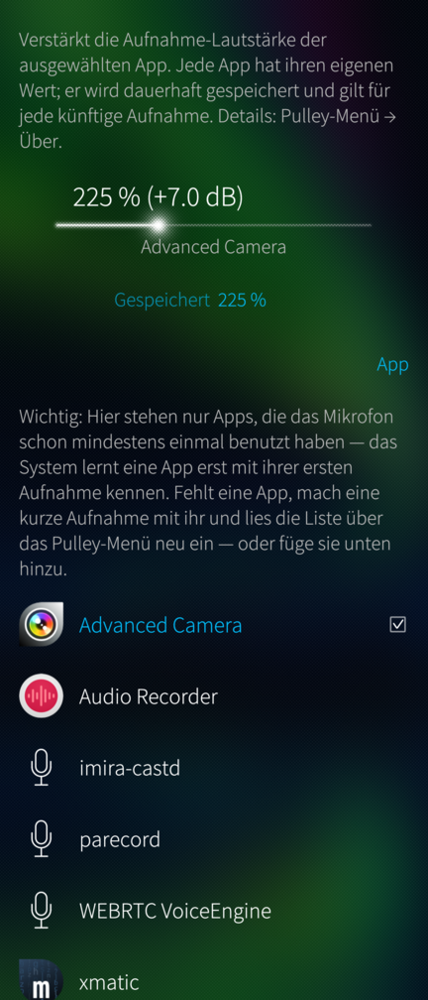
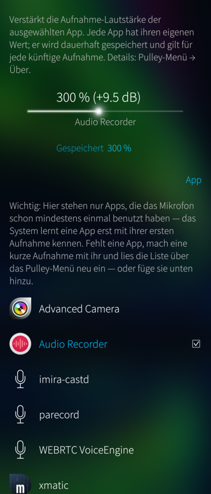

# Mic Gain — fix quiet recordings on Sailfish OS

**One slider that makes microphone recordings audible again.** Persistent,
per app, no root, fully revertible.

<br clear="left">

<p>


</p>

## How this app came about

While building [harbour-imira](https://github.com/JimKnopfIoT/harbour-imira)
— Miracast screen mirroring for Sailfish OS — the cast's audio sounded tinny,
far too quiet, and produced feedback. The cause turned out to be surprising:
Sailfish's audio policy silently re-routes *every* record stream onto the
active input, so the cast was transmitting the **microphone** instead of the
sink monitor it had asked for.

That detour through the audio stack raised an old question: why are camera
videos recorded on this platform so quiet you can barely hear them? A day of
measurements later the trail ended one layer further down — and this app is
the practical fix.

## The problem

On some Sailfish OS devices (measured in detail on the **Xperia 10 III**),
recordings made with camera and audio apps
such as Advanced Camera or Audio Recorder are 20–25 dB too quiet. Speech
peaks around −30 dBFS where a normal recording sits at −6…−12 dBFS.

The apps are innocent, and so is PulseAudio's configuration:

- A recording's audio track contains **exactly** the samples PulseAudio
  delivers (verified by recording the same moment in parallel from the
  PulseAudio source — the files match).
- Every volume involved — source, stream, ports — sits at 100 %, nothing is
  muted, switching between the microphones changes nothing.
- A live experiment during a running video recording: raising the record
  stream's PulseAudio volume mid-recording makes the file audibly louder at
  exactly that moment. The gain knob works — it just defaults to a value that
  cannot compensate what is lost below.

What is lost below: the **Android audio HAL** — the vendor driver layer
Sailfish OS reuses through libhybris — is configured with a far too low
microphone input gain for the camcorder path. Fixing it properly would mean
changing vendor audio configuration on the device.

## How the fix works

PulseAudio remembers a volume per application (stream-restore) and re-applies
it to every new stream of that application — persistently, across reboots.
Mic Gain writes a boosted recording volume into exactly that memory:

- Sailfish's `module-stream-restore-nemo` does not speak the standard
  `ext-stream-restore` protocol, so the database cannot be edited directly.
  Instead the app briefly opens a record stream *under the selected app's
  name* and sets its volume — the module persists the value under the shared
  restore id. The microphone is active for a fraction of a second; nothing is
  recorded or stored.
- The boost then applies automatically to every future recording of that app.
  Mic Gain does not need to be running for that.
- Everything is per app and revertible at any time ("Reset to 100 %").

The app lists every application that has ever recorded on the device (parsed
from the stream-restore database), with their launcher icons; any other
installed app can be added through a picker — the entry is created up front
and takes effect with that app's first recording.

Default is **300 % (+9.5 dB)**, adjustable 50–600 %. Digital gain has the
usual trade-off: the noise floor rises by the same amount, and values above
roughly 400 % can clip loud sounds.

## Usage

1. Install the RPM (see below), open **Mic Gain**.
2. Pick the app you want to fix — Advanced Camera and Audio Recorder are
   pre-listed.
3. Leave the slider at 300 % or adjust; the value is stored the moment you
   release it. Done — make a test recording.

## Installing

Grab the RPM from the [releases](../../releases) and install it, e.g.:

```sh
pkcon install-local harbour-micgain-*.aarch64.rpm
```

Sandboxing is disabled for this app on purpose: inside a Sailjail sandbox the
record stream is proxied and the restore id no longer matches the target
app's, which would make the written entry useless.

## Building

With the Sailfish Platform SDK:

```sh
mb2 -t SailfishOS-5.0.0.62-aarch64 build
```

## License

GPL-3.0-or-later. No warranty — but the whole change is a single volume value
in the user's own PulseAudio configuration, and "Reset to 100 %" restores the
system default at any time.
